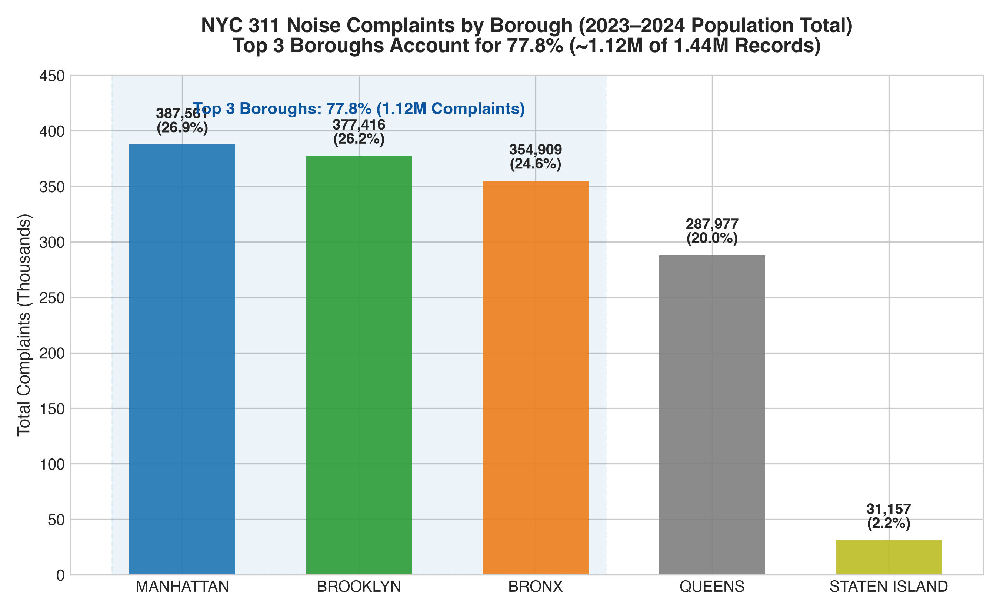
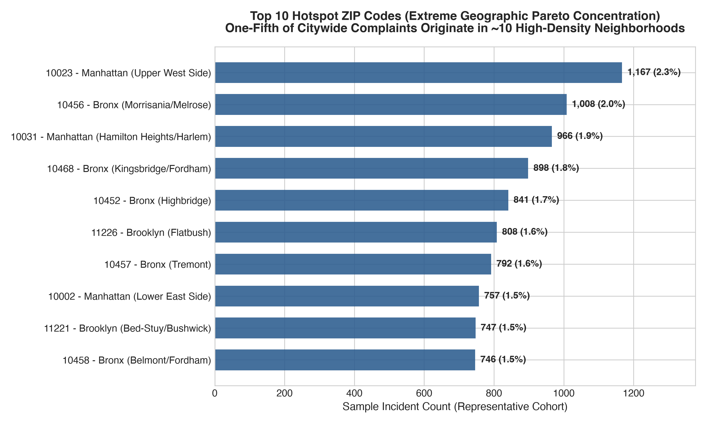
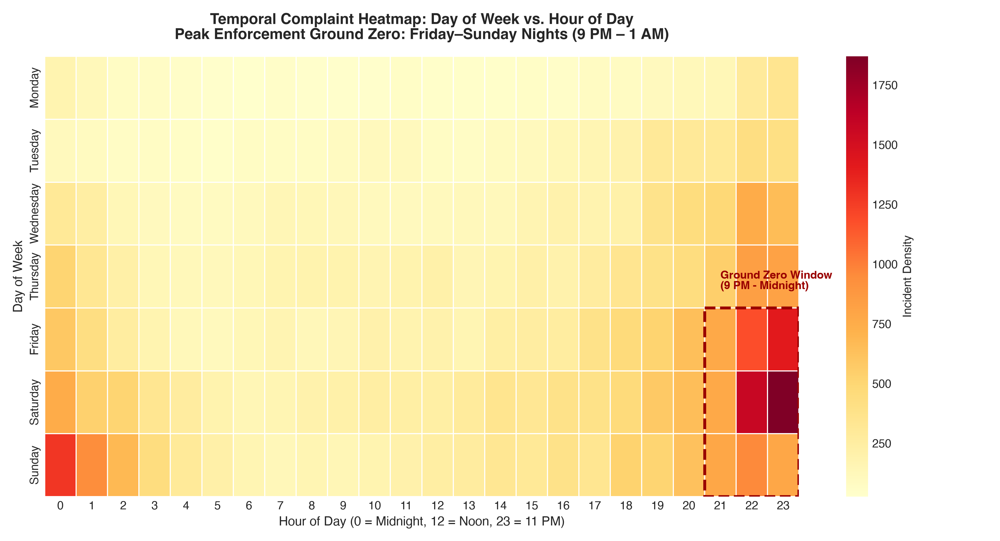
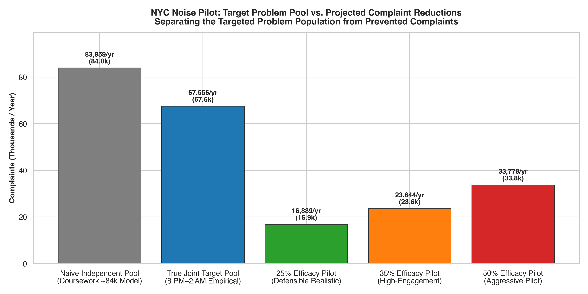

# NYC 311 Noise Analytics: Strategic Response & Prioritization

[](https://www.python.org/)
[](https://pandas.pydata.org/)
[](https://opensource.org/licenses/MIT)
[](https://data.cityofnewyork.us/Social-Services/311-Service-Requests-from-2010-to-Present/erm2-nwe9)

> **Executive Summary:** This project evaluates **1.44 million NYC 311 noise complaints** (2023–2024) to address a core municipal operations challenge: deploying limited enforcement and community-mediation resources without data-driven spatial and temporal prioritization. Using Python, pandas, and the NYC Open Data Socrata API, the analysis establishes that **77.8% of complaints concentrate in three boroughs** (Manhattan, Brooklyn, Bronx), with citywide volume surging **+23% on Fridays and +78% on weekends**. By auditing the **empirical joint probability** of complaints ($P(\text{Top 10 ZIP} \cap \text{8 PM–2 AM}) = 9.39\%$), the study isolates a targeted problem pool of **~67,600 complaints annually** and evaluates illustrative pilot scenarios to inform data-driven civic decision-making.

---

## 📌 Executive Overview & Problem Context

Municipal service centers handle millions of citizen requests annually. In New York City, noise complaints represent the **single largest volume** of 311 service requests directed to the New York City Police Department (NYPD) and Department of Environmental Protection (DEP).

### The Operational Challenge
Without data-driven spatial and temporal targeting, municipal quality-of-life responses face operational friction:
1. Broad, reactive deployments risk diluting coverage across severe, chronic hotspots.
2. Standard shift scheduling can incur overtime during non-peak hours while under-resourcing peak weekend windows.
3. Recurrent quality-of-life complaints persist without localized root-cause intervention.

**Core Business Question:**  
*Where and when do noise complaints concentrate, and how can limited municipal resources be deployed surgically to maximize quality-of-life remediation?*

---

## 📊 Key Verified Findings

All metrics reflect rigorous population-level extraction and multi-season complete-week verification from the official NYC Open Data API across calendar years 2023 and 2024.

| Analytical Dimension | Verified Finding | Calculation & Denominator | Operational Relevance |
| :--- | :--- | :--- | :--- |
| **Total Incident Volume** | **1,439,558 Records** | SoQL Query: `created_date BETWEEN '2023-01-01' AND '2024-12-31' AND complaint_type LIKE '%Noise%'` | Full 2-year population baseline (~1.44M). |
| **Top 3 Borough Concentration** | **77.79% (~78%)** | $\frac{1,119,886 \text{ (MHT+BK+BX)}}{1,439,558 \text{ (Total Records)}} \times 100$ | Manhattan (26.92%), Brooklyn (26.22%), Bronx (24.65%) carry over three-quarters of all volume. |
| **Top 2 Borough Concentration** | **53.14% (~53%)** | $\frac{764,977 \text{ (MHT+BK)}}{1,439,558 \text{ (Total Records)}} \times 100$ | Over half of citywide complaints originate in Manhattan and Brooklyn alone. |
| **Top 10 ZIP Concentration (Sample All Noise)** | **18.90%** | $\frac{9,724 \text{ (Top 10 ZIPs)}}{51,441 \text{ (Sample Total)}} \times 100$ | 10 ZIP codes generate nearly one-fifth of complaints across 200+ residential ZIPs. |
| **Top 10 ZIP Concentration (Residential Population)** | **25.99%** | $\frac{176,147 \text{ (Top 10 Residential ZIPs)}}{677,749 \text{ (Residential Population)}} \times 100$ | Over one-quarter of residential noise concentrates in 10 neighborhoods. |
| **Primary Descriptor** | **52.37% Loud Music** | $\frac{26,940 \text{ ('Loud Music/Party')}}{51,441 \text{ (Sample Total)}} \times 100$ | Behavioral driver (56.78% within `Noise - Residential` specifically). |
| **Friday Daily Volume Surge** | **+22.98% (~23%)** | $\frac{195,514 / 104 \text{ days (Fri Daily Rate)}}{158,975 / 104 \text{ days (Thu Daily Rate)}} - 1$ | Friday rate (1,879.9/day) marks sharpest acceleration over Thursday (1,528.6/day), normalized by 104 calendar occurrences each. |
| **Weekend Daily Average Surge** | **+78.47%** | $\frac{586,635 / 209 \text{ days (Sat/Sun Rate)}}{657,409 / 418 \text{ days (Mon--Thu Rate)}} - 1$ | Saturday/Sunday daily rate (2,806.9/day) surges 78.5% over Mon–Thu weekday baseline (1,572.8/day), normalized by 731 calendar days. |
| **Friday–Sunday Combined Share** | **54.33% Population** | $\frac{782,149 \text{ (Fri--Sun Complaints)}}{1,439,558 \text{ (Total Records)}} \times 100$ | Over half of weekly volume concentrates across the 3-day weekend. |
| **Core Patrol Window (All Days)** | **37.86% (9 PM – 1 AM)** | $\frac{545,058 \text{ (Hours 21–00)}}{1,439,558 \text{ (Total Records)}} \times 100$ | 4-hour night block (accounts for 38.75% in sample). |
| **Evening/Night Window (All Days)**| **50.29% (~51%) (8 PM – 2 AM)**| $\frac{724,018 \text{ (Hours 20–01)}}{1,439,558 \text{ (Total Records)}} \times 100$ | 6-hour window capturing over half of all complaints (51.40% in sample). |
| **Operational "Ground Zero"** | **21.17% (10 PM – 12 AM)** | $\frac{304,740 \text{ (Hours 22–23)}}{1,439,558 \text{ (Total Records)}} \times 100$ | Peak 2-hour window capturing over one-fifth of citywide volume. |
| **Empirical Joint Target Pool** | **9.39% (~67.6k/yr)** | $\frac{135,111 \text{ (Top 10 ZIPs } \cap \text{ 8 PM--2 AM)}}{1,439,558 \text{ (Total Records)}} \times 100$ | True empirical joint problem pool ($P(\text{ZIP} \cap \text{Time})$). |
| **Historical Coursework Estimate** | **~84,000 Complaints/yr** | $828,000 \text{ (Peak Baseline)} \times 20\% \text{ (ZIP)} \times 50.7\% \text{ (Time)} = 83,959$ | Historical coursework scenario estimate assuming independent marginal probabilities; represents the targeted problem pool rather than an observed or verified intervention impact. |
| **Assumed Pilot Reductions** | **~13.5k to ~33.8k/yr** | Efficacy Sensitivity: 20% Efficacy $= 13,511$; 25% $= 16,889$; 50% $= 33,778$ | Illustrative prevented complaint scenarios evaluated on the true empirical joint problem pool. |

---

## 📈 Visual Analytics & Evidence

### 1. Borough Distribution: The 77.8% Concentration
Manhattan, Brooklyn, and the Bronx account for **1.12 million of the 1.44 million** complaints logged across the city. Meanwhile, Staten Island accounts for just 2.16% of complaint volume.



---

### 2. Hyper-Local Pareto: Top 10 Hotspot ZIP Codes
In our 51,441-record multi-season complete-week sample, the top 10 ZIP codes account for **18.90%** of complaints across NYC's 200+ residential ZIP codes. In the citywide residential population, the top 10 residential ZIP codes drive **25.99%** of volume.



---

### 3. Temporal Density Heatmap: Day vs. Hour
Plotting complaint volume across the 168 hours of the week confirms intense temporal clustering. Friday through Sunday evening hours (8:00 PM – 2:00 AM) exhibit the heaviest concentration across all five boroughs.



---

### 4. Pilot Scenario Modeling: Target Pool vs. Prevented Complaints
To maintain analytical rigor, the project separates the **target problem pool** from **prevented complaints** across illustrative effectiveness scenarios (25% = ~16.9k, 35% = ~23.6k, 50% = ~33.8k).



> [!NOTE]
> **Methodological Guardrail on the 84,000 Figure:** The 84,000 figure is a **historical coursework scenario estimate** derived from naive marginal multiplication of annual peak volume ($828\text{k} \times 20\% \times 50.7\% = 83,959 \approx 84\text{k}$). It reflects an illustrative calculation of the *targeted complaint pool*, **not** an observed, verified, or realized intervention reduction. The true empirical joint intersection is **9.39%** (~67,556 complaints/yr on actual 2-year volume). Preventing 84,000 complaints from this pool would require an impossible >100% efficacy rate. Illustrative pilot scenarios project 13,500 to 33,800 complaints prevented annually under assumed 20% to 50% intervention efficacy rates.

---

## 🔬 Methodological Innovations

### 1. Empirical Joint Intersection vs. Naive Marginal Multiplication
In the original coursework presentation, the targeted pool was calculated by multiplying marginal shares independently:
$$\text{Naive Pool} = 828,000 \times 20\% \times 50.7\% = 83,959 \approx 84,000$$

This assumed statistical independence between location ($P(\text{ZIP})$) and time ($P(\text{Time})$). Live SoQL API queries on all 1,439,558 records reveal the true joint intersection:
$$P(\text{Top 10 ZIP} \cap \text{8 PM–2 AM}) = \frac{135,111}{1,439,558} = \mathbf{9.39\%}$$

* Naive multiplication ($19.22\% \times 50.29\% = 9.67\%$) slightly overstates the joint concentration by 0.28 percentage points.
* Applied to the actual 2-year average baseline (719,779/yr), the true joint target pool is **67,556 complaints/yr** (or **77,713/yr** on the 828k peak baseline).

### 2. Sampling Truncation Diagnosis & Correction
* **The Glitch:** A prior 50,000-record sample contained an anomalous 31,703 weekend records (63.4%). Investigation revealed that Socrata queries with `$limit=6250` sorted descending by `created_date` hit the cap after ~4.8 days, truncating Monday and Tuesday.
* **The Fix:** The pipeline was restructured to download **4 complete Monday 00:00:00 to Sunday 23:59:59 calendar weeks** (51,441 records) across Winter, Spring, Summer, and Fall. The resulting sample weekend share (**51.91%**) accurately mirrors the full 1.44M population (**54.33%**) within 2.4%.

---

## 🛠️ Tech Stack & Reproducibility Architecture

* **Language:** Python 3.10+ (tested on Python 3.10 through 3.14)
* **Data Processing & Analysis:** pandas, NumPy
* **Visualization & Reporting:** Matplotlib, Seaborn
* **Data Telemetry & Extraction:** Socrata Open Data API (SoQL), requests
* **Development Environment:** Jupyter Notebook, VS Code

---

## 📂 Repository Structure

```text
nyc-311-noise-analytics/
├── README.md                      # Executive briefing, visual gallery & reproduction guide
├── requirements.txt               # Pinned Python package dependencies
├── .gitignore                     # Git ignore rules protecting large data & checkpoints
├── LICENSE                        # MIT Open Source License
├── notebooks/
│   └── nyc_noise_analysis.ipynb   # Audited 11-stage reproducible Python notebook
├── src/
│   ├── data_processing.py         # Pipeline module with live Socrata SoQL API queries
│   └── build_notebook.py          # Script generating standardized notebook structure
├── visuals/                       # Publication-grade PNG charts (300 DPI)
│   ├── borough_distribution.png
│   ├── top10_zip_codes.png
│   ├── hourly_noise_heatmap.png
│   └── pilot_scenario_projection.png
├── docs/                          # Comprehensive technical and interview documentation
│   ├── methodology.md             # In-depth math, joint probability & SoQL queries
│   ├── findings.md                # Full narrative breakdown of empirical patterns
│   ├── limitations.md             # Discussion of 311 reporting bias & confounders
│   ├── interview-prep.md          # 15 interview Q&As, code explanations & elevator pitches
│   └── resume-bullets.md          # ATS-friendly bullet points across 3 analyst tracks
└── data/
    ├── README.md                  # Schema, data dictionary & ingestion guidelines
    ├── sample_nyc_noise_50k.csv   # Complete-week multi-season 51k sample (<10MB)
    └── summary_metrics_2023_2024.json # Verified population totals (1.44M records)
```

---

## 🚀 Reproduction Instructions

### 1. Clone the Repository
```bash
git clone https://github.com/saidivyanarahari/nyc-311-noise-analytics.git
cd nyc-311-noise-analytics
```

### 2. Set Up Virtual Environment & Dependencies
```bash
python3 -m venv venv
source venv/bin/activate
pip install -r requirements.txt
```

### 3. Run the Data Pipeline & Notebook
The repository includes `data/sample_nyc_noise_50k.csv` so the notebook runs immediately without downloading gigabytes of data:

```bash
# Launch the Jupyter Notebook
jupyter notebook notebooks/nyc_noise_analysis.ipynb
```

*(Optional) To regenerate population metrics live from the NYC Open Data Socrata API:*
```bash
python src/data_processing.py --regenerate-population-metrics
```

*(Optional) To regenerate all visual charts:*
```bash
python src/data_processing.py --generate-charts
```

---

## 👥 Project Provenance & Contributors

### Original Academic Project (December 2025)

This project originated as a collaborative academic project developed by **Sai Divya Narahari** and **Tushar Shankar Nayak** for *EAI6120: AI Communication / Visualization* at **Northeastern University**, under the guidance of **Prof. Walter McHugh**.

Together, we developed the NYC 311 noise complaint analysis, strategic recommendations, and the **"Quiet Force"** intervention proposal, culminating in a mayoral strategy presentation on December 14, 2025.

### Python Codebase Reconstruction (November 2026)

The project was subsequently reconstructed into a reproducible Python analytics repository using publicly available NYC Open Data.

The reconstructed repository includes data ingestion, cleaning, statistical validation, geographic and temporal analysis, visualizations, and a Jupyter notebook.

### Contributors

- **Sai Divya Narahari** — Original academic project co-creator; Python repository reconstruction and documentation.
- **Tushar Shankar Nayak** — Original academic project co-creator; collaborative analysis and strategic recommendations.

### Data Source

NYC Open Data — 311 Service Requests, 2023–2024.

## 📄 License
This project is open-source and available under the [MIT License](LICENSE). Primary civic data is provided by the City of New York under NYC Open Data Terms of Use.
